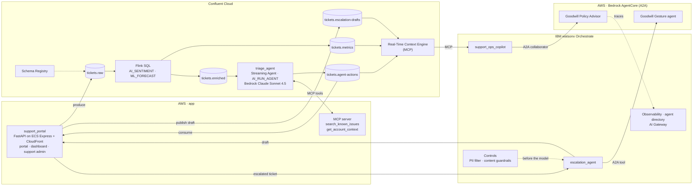
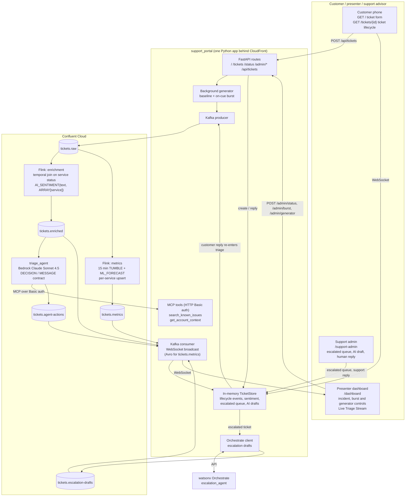

# Architecture

The demo follows one support ticket from the customer's click to the advisor's reply. **Confluent** turns every ticket into an event and makes decisions next to the data. **watsonx Orchestrate** makes agents act under control, wherever they run. **AWS** hosts the app and two partner agents that Orchestrate federates.

## End-to-end view

## Components

| Layer | Component | Role in the demo |
|---|---|---|
| App | `support_portal` (FastAPI) | Ticket form, presenter dashboard, `/support-admin` queue, synthetic generator, MCP server for the triage agent, client of the escalation agent |
| Confluent | Kafka topics + Schema Registry | One topic per stage; every message follows a registered schema |
| Confluent | Flink SQL | Enrichment with the live service status and `AI_SENTIMENT`; per-service volume forecast with `ML_FORECAST` |
| Confluent | Streaming Agent `triage_agent` | Runs in the stream (`AI_RUN_AGENT`), calls the app's MCP tools, decides *resolve* or *escalate* |
| Confluent | Real-Time Context Engine | Exposes the live topics over MCP to the Orchestrate copilot |
| Orchestrate | `escalation_agent` | Drafts the reply and the goodwill gesture for an escalated ticket; the human reviews and sends |
| Orchestrate | Controls | `pii_escalation_input` masks personal data, `escalation_guardrails` blocks injection and inappropriate content, both before the model |
| Orchestrate | `support_ops_copilot` | Answers the support manager on live data; hands goodwill-policy questions to the AWS advisor |
| AWS | Goodwill Gesture agent | Applies the (fictional) compensation charter, returns JSON; called as a tool by the escalation agent |
| AWS | Goodwill Policy Advisor | Explains the policy; collaborator of the copilot; sends its own traces to Orchestrate |

## Topics

| Topic | Producer | Consumers |
|---|---|---|
| `tickets.raw` | App (form and generator) | Flink enrichment and metrics |
| `services.status` | App (presenter controls) | Flink enrichment (temporal join) |
| `tickets.enriched` | Flink | Triage agent, dashboard |
| `tickets.metrics` | Flink (`ML_FORECAST`, Avro) | Dashboard, copilot |
| `tickets.agent-actions` | Triage agent | App (ticket timeline), dashboard, copilot |
| `tickets.escalation-drafts` | App (escalation agent's drafts) | App, copilot |

## Key design choices

- **The AWS goodwill agent is a tool, not a collaborator.** As a collaborator it takes over the turn and the escalation agent can no longer write its synthesis. The policy advisor is a collaborator of the copilot, where handing over the turn is the desired behaviour.
- **Controls run on `agent_pre_invoke`.** The model never sees raw personal data or the injection attempt.
- **Drafts are published to Kafka.** The copilot and any other team can reuse them through the Real-Time Context Engine: produce once, consume many.
- **`tickets.metrics` uses Avro.** `ML_FORECAST` returns a `TIMESTAMP(6)` field that the JSON Schema format cannot represent.
- **The MCP server is mounted at `/` with Basic auth.** Mounting at `/mcp` makes Starlette 307-redirect bare POSTs, which the Flink MCP client does not follow; the open endpoint was probed by bots within hours.

More decisions and their history: [project-spec.md](project-spec.md).

## Inside the app and the triage pipeline

An editable whiteboard version of the full architecture is in [architecture.excalidraw](architecture.excalidraw) (open it on [excalidraw.com](https://excalidraw.com)).
